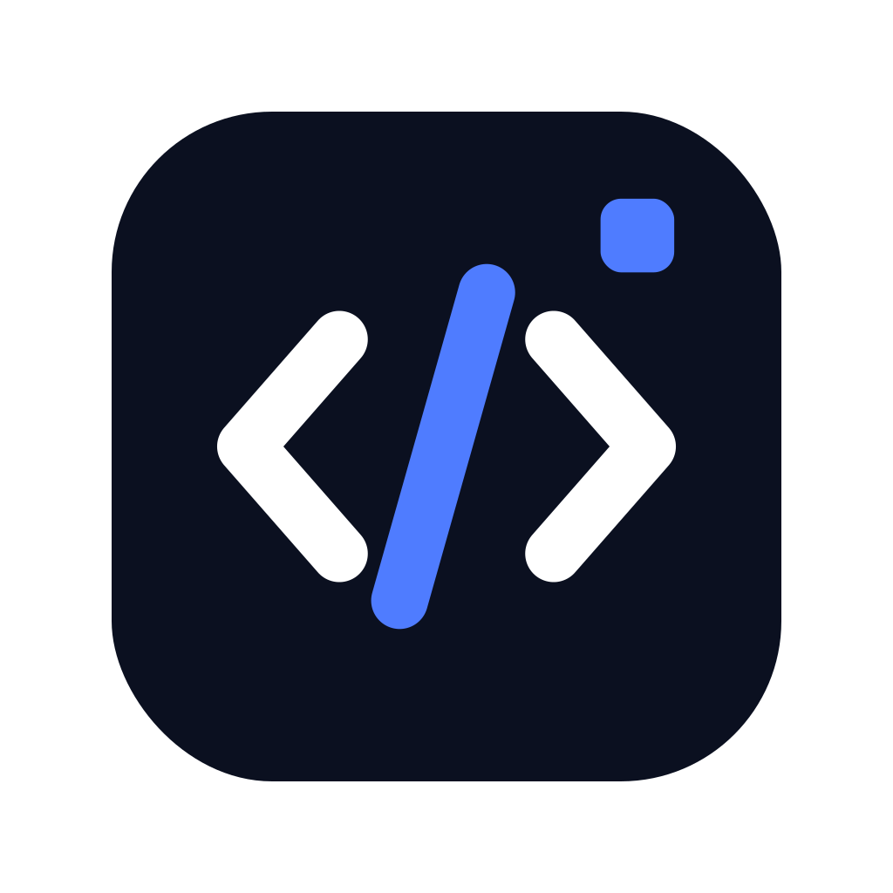
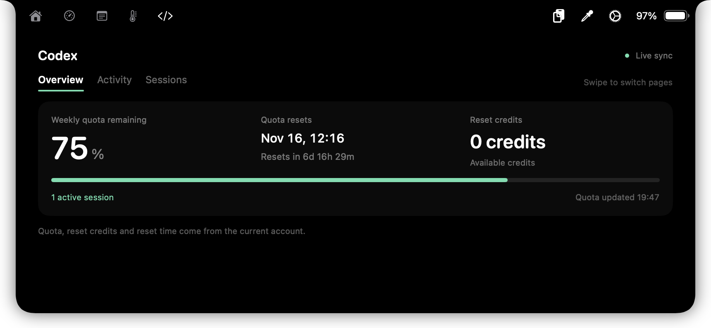
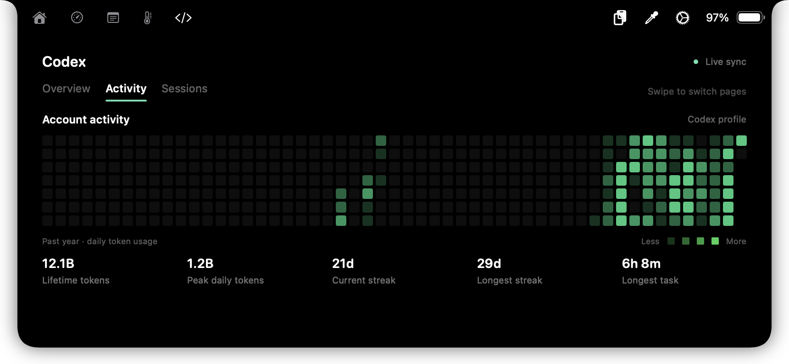
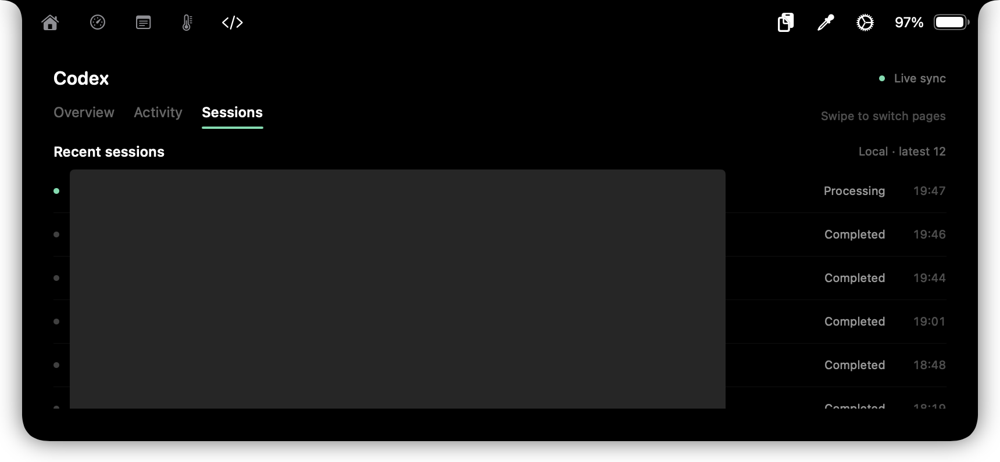
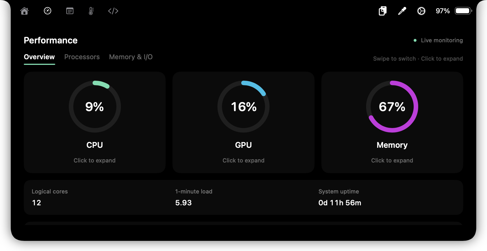
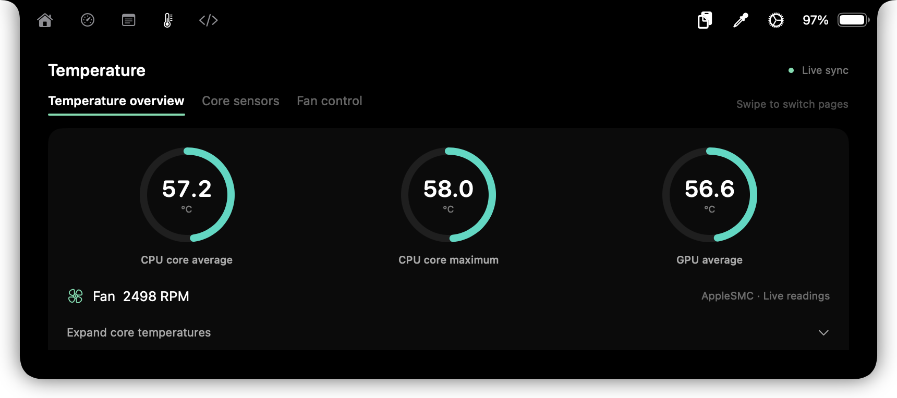
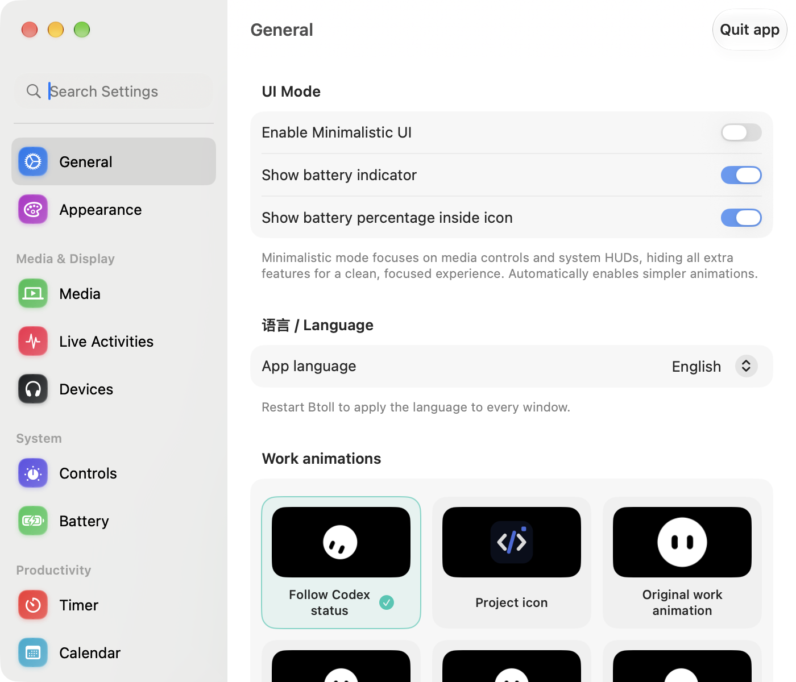

<p align="center"></p>
<h1 align="center">Btoll</h1>
<p align="center"><a href="ReadMe.md">简体中文</a> · English</p>
<p align="center">A Mac notch workspace for Codex, performance, temperatures and fans.</p>

An independent open-source extension of [Atoll](https://github.com/Ebullioscopic/Atoll) v2.3.3, preserving its history and GPL-3.0 license. Thanks to the Atoll and boring.notch contributors. This project is independent of the original authors, Apple and OpenAI.

## Installation

Download `Btoll-1.1.0-arm64.pkg` from this repository's **Releases**. Supports **Apple Silicon Macs running macOS 14.6 or later**. The installer includes the app, independent fan service, Node runtime and native sensor readers. Homebrew, Python and Xcode are not required on the destination Mac.

Open **Btoll** in Applications. Codex data belongs to the current Mac's signed-in Codex account and local sessions. No developer credentials or chat history are included. First launch installs a per-user monitor with live-activity and notch-content access only; existing preferences and revoked permissions are preserved.

The app is ad-hoc signed; the installer is unsigned and has not been notarized by Apple. If macOS blocks it, review it in **System Settings → Privacy & Security → Open Anyway**. Keep macOS security protections enabled.

## Language

Choose **Settings → General → 语言 / Language → English, 简体中文 or Follow system**, then restart Btoll when prompted. One installer supports both languages. Preferences and session data are preserved.

## Features

- Codex quota, reset time and reset credits, recent sessions and status, and the personal activity grid.
- 28 original Grok Bot animations. Follow actual Codex processing, tool work, responding, input waits and completion; multiple clips connect within each state. Individual selection and Lottie imports are also available.
- CPU, GPU and memory rings with three horizontal pages and expandable details.
- Processes with app icons, search and CPU/memory sorting; network and disk I/O by app, volumes and network interfaces.
- Battery health, cycles, charging/discharging power and temperature; thermal pressure and processes keeping the Mac awake.
- Real CPU core-region temperatures, using chip-specific sensor mappings. Missing readings stay unavailable.
- Independent SMC fan control: automatic, half speed, three-quarter speed, full speed and custom RPM. Manual modes expire after at most 10 minutes, enforced by the service.
- Lock-screen presentation, file-drop and timer navigation entries removed. Existing desktop and fullscreen Space behavior is preserved.

Fanless Macs have no speed controls. Sensor support varies by model. Hardware validation has been performed on an M6 Mac; support for other M-series models and macOS 14.6 is based on deployment targets and sensor mapping checks, not a full hardware test matrix. Avoid simultaneous fan controllers.

## Screenshots

### Codex

| Quota, reset time and credits | Personal activity grid |
| --- | --- |
|  |  |



One continuous opaque rectangle covers session titles and project names. Status and timestamps remain visible. Screenshots use the running app and real account data.

### System monitoring

| Performance | Temperatures |
| --- | --- |
|  |  |



Expanding details extends the entire notch downward, up to about three quarters of the screen. Additional content scrolls inside.

## Building from source

Requires an Apple Silicon Mac, full Xcode, CMake and the Metal Toolchain required by the project dependencies.

```sh
./scripts/build-btoll.sh
```

Outputs are written to `dist/`. The script verifies the pinned Node SHA-256 and builds native helpers and the fan service from source. Private runtime data is excluded. This fork does not use Atoll's upstream automatic update feed.

[Install and uninstall](docs/INSTALL.en.md) · [Upstream README](docs/UPSTREAM_README.md) · [Third-party notices](THIRD_PARTY_NOTICES.md) · [GPL-3.0](LICENSE)
