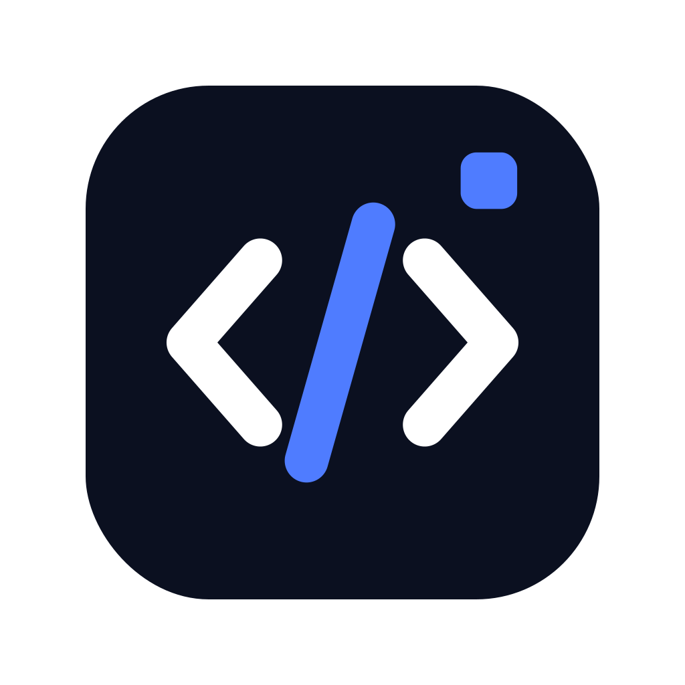

<p align="center"></p>
<h1 align="center">Btoll</h1>
<p align="center">Mac 刘海工作台 · Codex · 性能 · 温度与风扇</p>

基于 [Atoll](https://github.com/Ebullioscopic/Atoll) v2.3.3 延伸开发的独立开源分支，保留原项目历史及 GPL-3.0 许可。感谢 Atoll 与 boring.notch 的贡献者。本项目不代表原作者，也不与 Apple 或 OpenAI 存在隶属关系。

## 安装

在本仓库 **Releases** 下载 `Btoll-1.0.0-arm64.pkg`。适用于 **Apple Silicon（M 系列），macOS 14.6 或更新版本**。安装包包含应用、独立风扇服务、Node 运行时和原生温度读取器；目标 Mac 无需 Homebrew、Python 或 Xcode。

安装后在“应用程序”打开 **Btoll**。Codex 数据来自这台 Mac 自己的 Codex 登录与会话；不包含作者的账号、密钥或聊天记录。首次启动会安装当前用户的本地监控扩展，并仅授权实时活动和刘海内容；已有用户的设置与撤销授权会保留。

安装包为本地临时签名，尚未经过 Apple 公证。如 macOS 拦截，请在“系统设置 → 隐私与安全性”中核对应用后使用“仍要打开”。无需关闭系统安全保护。

## 功能

- Codex 配额、重置时间与重置卡、最近会话和状态、个人活动方格图。
- CPU、GPU、内存环形进度，三页横向切换及详细性能数据。
- 带图标的完整进程列表，搜索与 CPU／内存排序；按应用汇总网络和磁盘 I/O，查看磁盘卷及网卡详情。
- 电池健康、循环次数、充放电功率和温度；查看系统热压力与正在阻止休眠的进程。
- 读取真实 CPU 核心温度；按芯片系列映射传感器，无数据时显示不可用。
- 独立 SMC 风扇控制：自动、半速、3/4、全速及自定义 RPM；手动模式最长 10 分钟，服务端到期恢复自动。
- 移除锁屏展示与文件投放、定时入口；保留原有桌面与全屏空间行为。

无风扇机型不提供调速。传感器和 SMC 能力因型号而异；当前实机验证为 M6，其他 M 系列及 macOS 14.6 的兼容范围基于构建目标与映射检查，尚未逐一实测。请勿同时运行多个风扇控制器。

## 从源码构建

需要 Apple Silicon Mac、完整 Xcode 及项目依赖所需的 Metal Toolchain。

```sh
./scripts/build-btoll.sh
```

输出位于 `dist/`；构建脚本校验固定版本 Node 的 SHA-256，并从本仓库源码编译原生辅助程序与风扇服务。安装包源码不包含私有运行数据。自定义分支不使用上游 Atoll 自动更新通道。

[安装与卸载](docs/INSTALL.zh-CN.md) · [上游说明](docs/UPSTREAM_README.md) · [第三方声明](THIRD_PARTY_NOTICES.md) · [GPL-3.0](LICENSE)
